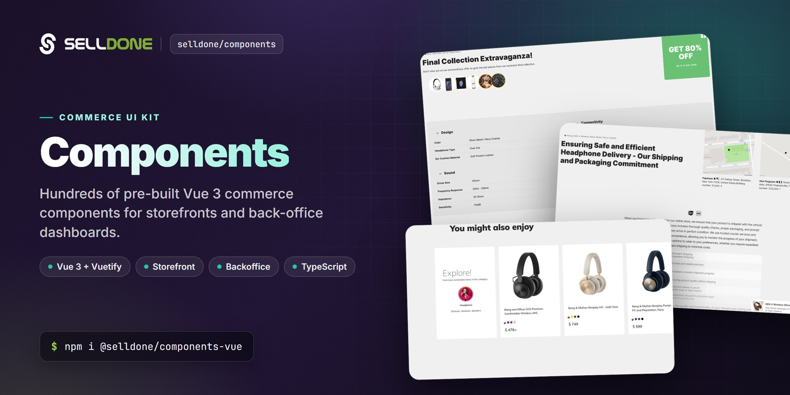

<p align="center">
  
</p>

<p align="center">
  <a href="https://www.npmjs.com/package/@selldone/components-vue"></a>
  <a href="https://www.npmjs.com/package/@selldone/components-vue"></a>
  <a href="LICENSE.md"></a>
  
  <a href="https://github.com/selldone/components/wiki"></a>
  <a href="https://selldone.com"></a>
  <a href="https://app.codacy.com/gh/selldone/components/dashboard?utm_source=gh&utm_medium=referral&utm_content=&utm_campaign=Badge_grade"></a>
</p>

<p align="center">
  <b>Pre-built Vue 3 commerce components for building white-label Selldone storefronts and dashboards.</b><br>
  <a href="https://github.com/selldone/components/wiki">Documentation</a> ·
  <a href="#quick-start">Quick start</a> ·
  <a href="https://github.com/selldone">Ecosystem</a> ·
  <a href="https://selldone.com">Selldone.com</a> ·
  <a href="https://github.com/selldone/components/issues">Report an issue</a>
</p>

<p align="center">
  <a href="https://github.com/selldone/storefront">Storefront</a> ·
  <a href="https://github.com/selldone/pagebuilder">Page Builder</a> ·
  <b>Components</b> ·
  <a href="https://github.com/selldone/storefront-sdk">Storefront SDK</a> ·
  <a href="https://github.com/selldone/backoffice-sdk">Backoffice SDK</a> ·
  <a href="https://github.com/selldone/vendor-sdk">Vendor SDK</a> ·
  <a href="https://github.com/selldone/community-sdk">Community SDK</a> ·
  <a href="https://github.com/selldone/core">Core</a> ·
  <a href="https://github.com/selldone/cli">CLI</a> ·
  <a href="https://github.com/selldone/translate">Translate</a>
</p>

## Overview

**Selldone Components** (`@selldone/components-vue`) is the open-source Vue 3 components library behind
[Selldone®](https://selldone.com) Business OS. It contains the pre-built commerce UI used by Selldone storefronts and
by the merchant dashboard: product cards, baskets and checkout widgets, order tracking, payment forms, maps, charts,
uploaders, article editors, community pages and hundreds of back-office tools.

The library is built with **Vue 3** and **Vuetify 3** and talks to Selldone through the official SDKs
([Storefront SDK](https://github.com/selldone/storefront-sdk), [Backoffice SDK](https://github.com/selldone/backoffice-sdk),
[Vendor SDK](https://github.com/selldone/vendor-sdk), [Community SDK](https://github.com/selldone/community-sdk)) and
shared models from [Core](https://github.com/selldone/core). Texts come from
[Translate](https://github.com/selldone/translate), so components are available in about 100 languages.

Use it to build a custom storefront (a Selldone *Layout*), to extend the Selldone dashboard, or to reuse individual
widgets in your own Vue app. The full [Storefront](https://github.com/selldone/storefront) project is the best
reference for how the pieces fit together.

- **Mode:** Public
- **Use case:** Pre-built Vue commerce components for both storefront and back office
- **Project type:** Vue components library

## Key features

- **More than 1,000 Vue components** — organized by audience in `storefront/`, `backoffice/`, `ui/`, `community/`, `article/` and `vendor/`.
- **Clear naming convention** — `S*` storefront, `B*` back office, `U*` generic UI, `C*` community (and `L*` for the [Page Builder](https://github.com/selldone/pagebuilder)), so you always know where a component belongs.
- **One-line setup** — `createComponents()` returns a Vue plugin that installs the core mixin, global components, directives and global helpers.
- **Commerce-ready storefront UI** — product cards and pages, basket items, checkout and payment widgets, order status and delivery tracking, coupons, gift cards, wallets, lotteries, comparison, cookie consent and more.
- **Back-office building blocks** — products, inventory, orders, customers, vendors, campaigns, discounts, taxes, logistics, domains, spreadsheets import, AI assistance and dashboards.
- **Payment UI** — components for Stripe, PayPal Standard, Razorpay, Mercado Pago, Paymob, Square and more (`ui/payment`).
- **Rich generic UI** — charts (ApexCharts, d3), maps (Mapbox), date and time pickers, currency and price inputs, uploaders (FilePond), QR and barcodes, Lottie, rating, smart selects and more.
- **Theming from your Layout** — a ready Vuetify instance (`VuetifyInstance(i18n)`) with Material and Font Awesome icon sets and theme colors read from meta tags.
- **Useful directives and services** — `v-copy`, `v-track`, `v-dragscroll`, `v-size`, `v-dynamic-scripts`, `NotificationService`, `EventBus` and shared mixins.
- **TypeScript source** — shipped as `.ts` and `.vue` source files for tree-shaking with modern bundlers such as Vite.

## Quick start

Install the package:

```bash
npm install @selldone/components-vue
```
```bash
yarn add @selldone/components-vue
```

Here's a basic example to get you started:

```javascript
import { createComponents } from "@selldone/components-vue/components";

const components = createComponents({});
app.use(components);
```

A typical storefront entry file also loads the icon fonts and uses the bundled Vuetify instance, as the
[Storefront](https://github.com/selldone/storefront) does:

```javascript
import { createApp } from "vue";
import { createComponents } from "@selldone/components-vue/components";
import { VuetifyInstance } from "@selldone/components-vue/plugins/vuetify/vuetify";
import { StorefrontSDK } from "@selldone/sdk-storefront";

// Icon fonts
import "@fortawesome/fontawesome-free/css/all.css";
import "@selldone/components-vue/style/fonts/material-design-fonts/material-design-icons.scss";

const app = createApp(App);
const vuetify = VuetifyInstance(i18n); // i18n = your vue-i18n instance

app.use(createComponents({}));
StorefrontSDK.Setup(); // window.$storefront for S* components

app.use(i18n);
app.use(router);
app.use(store);
app.use(vuetify);
app.mount("#app");
```

## Usage

### Import a component

Components are imported by path. The folder tells you the audience and the file name starts with the family prefix:

```vue
<template>
  <s-shop-product-card :product="product" />
  <u-price :amount="product.price" :currency="product.currency" />
</template>

<script lang="ts">
import SShopProductCard from "@selldone/components-vue/storefront/product/card/SShopProductCard.vue";

export default {
  components: { SShopProductCard }, // u-price is registered globally by createComponents()
  props: { product: Object },
};
</script>
```

### Component families

| Prefix | Folder | Audience | Examples |
|---|---|---|---|
| `S` | `storefront/` | Customer-facing storefront | `SShopProductCard`, `SShopBuyButton`, `SShopBasketItemsList`, `SStorefrontSearchBox`, `SFooterSection`, `SCookieConsent` |
| `B` | `backoffice/` | Merchant dashboard and admin tools | `BProductAddFull`, `BOrderButton`, `BInventoryList`, `BCustomerAdd`, `BVendorAdd`, `BSpreadsheet` |
| `U` | `ui/` | Generic UI usable anywhere | `UPrice`, `UCurrencyInput`, `UDateInput`, `UMapView`, `UChartLine`, `ULottie`, `USmartSelect` |
| `C` | `community/` | Community (posts, topics, comments) | `CPostWidget`, `CPostEditor`, `CCommentsList`, `CCategoryCard`, `CLayout` |
| — | `article/` | Blog and help articles | `SArticleEditor`, `SArticleComments`, `SArticleFaqs`, `SArticleTableOfContents` |
| `L` | [pagebuilder](https://github.com/selldone/pagebuilder) | Page Builder (separate package) | `LPageEditor`, `LPageViewer`, `LandingRender` |

See [Component Families](https://github.com/selldone/components/wiki/Component-Families) for the full folder map.

### What `createComponents()` installs

- `CoreMixin` as a global mixin (helpers such as `USER()`, `getShopImagePath()`, `getProductImage()`, `copyToClipboard()`, language helpers).
- Global components: `UCheck`, `u-price`, `ULoadingProgress`, `apexchart`, `u-qrcode`, `u-barcode`, `u-lottie`, `UButtonCircle`, `UTooltipTips`, `SWidget`, `UWidgetHeader`, plus the notification, numerals, mask, flag-icon and confetti plugins.
- Global directives: `v-copy`, `v-track`, `v-dynamic-scripts`, `v-dragscroll`, `v-size`.
- Global properties: `$SEO`, `GlobalRules`, `IMAGE_SIZE_SMALL`, `IMAGE_SIZE_BLOG`, `SUB_TOOLBAR_CONFIG` and `window`.

Register your own components and directives in the same call:

```javascript
app.use(
  createComponents({
    components: { MyBanner },
    directives: { focus: FocusDirective },
  }),
);
```

### Theme colors

`VuetifyInstance(i18n)` reads the primary and secondary colors from meta tags in your `index.html`:

```html
<meta name="color--theme-light" content="#70557e">
<meta name="color--theme-dark" content="#3a2c41">
<meta name="color--theme-deep-dark" content="#261b2d">
<meta name="color--theme-info" content="#9964e3">
```

The values above are the defaults. See [Theming and Styles](https://github.com/selldone/components/wiki/Theming-and-Styles).

### Notifications

```javascript
import NotificationService from "@selldone/components-vue/plugins/notification/NotificationService.ts";

NotificationService.showSuccessAlert(null, "Saved successfully.");
NotificationService.showErrorAlert(null, "Something went wrong.");
```

## Documentation

| Page | What you'll learn |
|---|---|
| [Home](https://github.com/selldone/components/wiki) | What the library contains and where it fits |
| [Getting Started](https://github.com/selldone/components/wiki/Getting-Started) | Install, register and render your first component |
| [Installation and Registration](https://github.com/selldone/components/wiki/Installation-and-Registration) | Everything `createComponents()` installs, peer setup, custom registrations |
| [Component Families](https://github.com/selldone/components/wiki/Component-Families) | Folder structure, naming prefixes and notable components |
| [Storefront vs Backoffice](https://github.com/selldone/components/wiki/Storefront-vs-Backoffice) | Which SDKs and globals each family needs |
| [Theming and Styles](https://github.com/selldone/components/wiki/Theming-and-Styles) | Vuetify instance, theme colors, fonts and SCSS |
| [Directives and Services](https://github.com/selldone/components/wiki/Directives-and-Services) | `v-copy`, `v-track`, `v-dragscroll`, `v-size`, notifications, event bus, mixins |
| [FAQ](https://github.com/selldone/components/wiki/FAQ) | Common questions and troubleshooting |
| [Contribution Guide](https://github.com/selldone/components/wiki/contribution-guide) | How to contribute and develop locally |

## How it fits in the ecosystem

Components is the shared UI layer of the Selldone open-source stack. The [Storefront](https://github.com/selldone/storefront)
and the [Page Builder](https://github.com/selldone/pagebuilder) are built from it, it calls Selldone APIs through the
SDKs, and it reads models and helpers from [Core](https://github.com/selldone/core) and texts from
[Translate](https://github.com/selldone/translate).

<p align="center">
  <a href="https://github.com/selldone#ecosystem"></a>
</p>

### Related projects

| Project | Why it matters here |
|---|---|
| [Storefront](https://github.com/selldone/storefront) | Full Vue 3 storefront built with these components ([wiki](https://github.com/selldone/storefront/wiki)) |
| [Page Builder](https://github.com/selldone/pagebuilder) | Visual page builder that reuses these components ([wiki](https://github.com/selldone/pagebuilder/wiki)) |
| [Storefront SDK](https://github.com/selldone/storefront-sdk) | `window.$storefront` API client used by `S*` components ([wiki](https://github.com/selldone/storefront-sdk/wiki)) |
| [Backoffice SDK](https://github.com/selldone/backoffice-sdk) | `window.$backoffice` / `window.API` used by `B*` components ([wiki](https://github.com/selldone/backoffice-sdk/wiki)) |
| [Core](https://github.com/selldone/core) | Shared models, enums and helpers |
| [Translate](https://github.com/selldone/translate) | Translation files for about 100 languages ([wiki](https://github.com/selldone/translate/wiki)) |

## Contributing

Contributions are welcome. Read the organization [Contributing guide](https://github.com/selldone/.github/blob/main/CONTRIBUTING.md),
the [Code of Conduct](https://github.com/selldone/.github/blob/main/CODE_OF_CONDUCT.md) and the
[contribution guide](https://github.com/selldone/components/wiki/contribution-guide) in the wiki.

For local development, link this library and the Selldone packages it depends on, as described in
[DEVELOPMENT.md](DEVELOPMENT.md):

```bash
# Link the library
yarn link

# Link other libraries to this project
yarn link "@selldone/core-js"
yarn link "@selldone/sdk-storefront"
yarn link "@selldone/sdk-backoffice"
yarn link "@selldone/sdk-community"
yarn link "@selldone/sdk-vendor"
yarn link "@selldone/page-builder"
```

## Security

Please do not report security vulnerabilities in public issues. Follow the organization
[Security policy](https://github.com/selldone/.github/blob/main/SECURITY.md) and email
[security@selldone.com](mailto:security@selldone.com).

## License

The repository includes the [MIT License](LICENSE.md) file. The copyright notice and the Selldone Ecosystem License
Agreement below are reproduced from the project documentation.

### Copyright notice

```
Copyright © 2023 Selldone®

All rights reserved. This software and associated documentation files (the "Software") are the property of Selldone®.
```

<details>
<summary>Selldone Ecosystem License Agreement</summary>

**Selldone Ecosystem License Agreement**

1. **Scope of License**: This license is granted exclusively for the use of the enclosed code (hereinafter referred to
   as "the Code") within the Selldone ecosystem. The licensee is authorized to use the Code solely in conjunction with
   services and applications that are part of, or directly related to, the Selldone ecosystem.

2. **Commercial Use Restriction**: The licensee is strictly prohibited from using the Code for any commercial purposes
   outside the Selldone ecosystem. Commercial utilization is permissible only when it is within the Selldone ecosystem
   and in accordance with the terms of this agreement.

3. **Permission for Free Use**: The Code may be used for non-commercial, free services, provided that explicit credit is
   given to Selldone. This credit must include the name "Selldone" prominently displayed on the user interface of the
   relevant service or application, along with a hyperlink to [selldone.com](https://selldone.com).

4. **No Redistribution**: The licensee may not redistribute the Code, in whole or in part, to any third party outside
   the Selldone ecosystem, unless expressly authorized by Selldone.

5. **No Modification for Redistribution**: While modifications to the Code for personal or internal use within the
   Selldone ecosystem are allowed, the licensee may not modify the Code for the purpose of redistribution outside the
   Selldone ecosystem.

6. **Termination**: Failure to comply with the terms of this agreement will result in the immediate termination of the
   license and may subject the licensee to legal action.

7. **Disclaimer of Warranty**: The Code is provided "as is" without any warranties of any kind, either expressed or
   implied, including but not limited to implied warranties of merchantability or fitness for a particular purpose.

8. **Limitation of Liability**: In no event shall Selldone be liable for any damages arising out of the use or inability
   to use the Code.

9. **Jurisdiction and Disputes**: This agreement shall be governed by the laws of the jurisdiction where Selldone is
   established. Any disputes arising from this agreement shall be resolved in the courts of that jurisdiction.

By using the Code, the licensee acknowledges that they have read, understood, and agreed to the terms of this license.

</details>

---
<p align="center"><sub>Part of the <a href="https://github.com/selldone">Selldone® Business OS</a> open-source ecosystem · <a href="https://selldone.com">selldone.com</a></sub></p>
